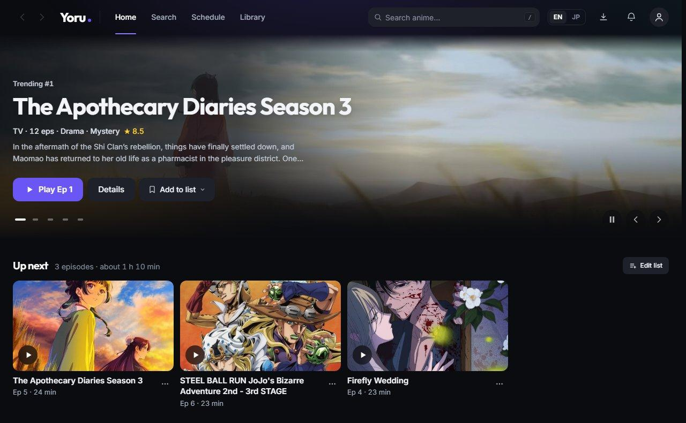
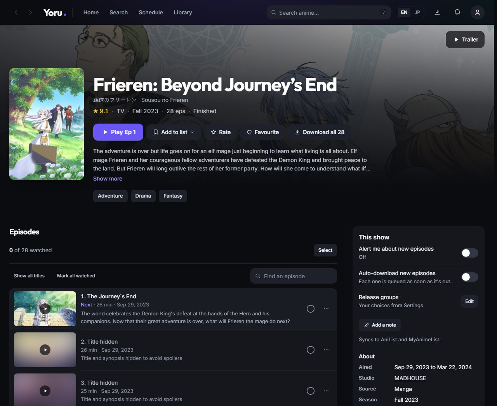
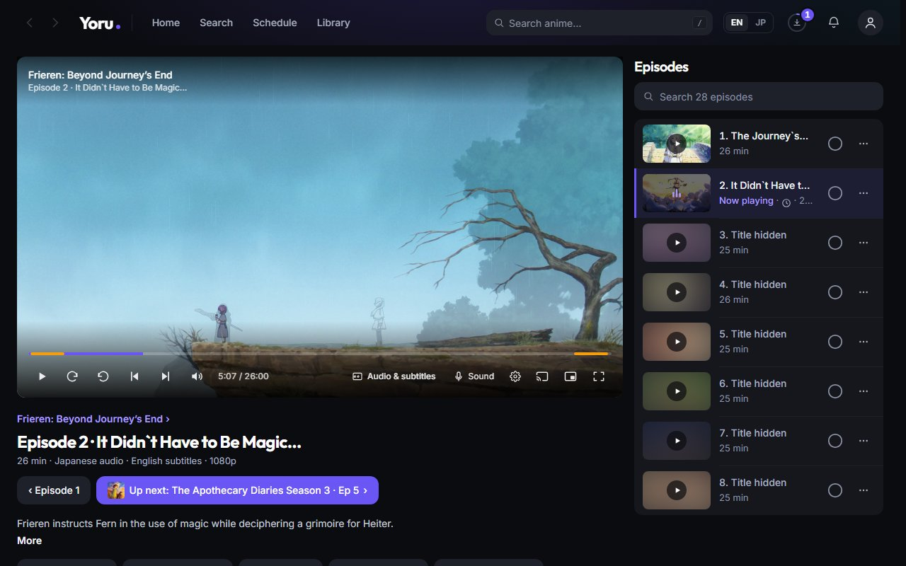

# Yoru

Self-hosted anime streaming.

[](https://github.com/Tons-7/yoru/releases/latest)
[](LICENSE.md)
[](go.mod)

Search any anime, press play, and it streams from a torrent while it downloads,
with no waiting for a complete file. Progress syncs to AniList and MyAnimeList
as you watch.

Everything runs on your own machine: one binary with a built-in torrent engine,
a browser player and one config file.



## What it does

- **Streams while downloading.** Seeking into a part not yet downloaded jumps
  ahead of everything else queued; the rest is fetched in the background so the
  next episode is already there.
- **Built-in torrent engine.** Picks the best release (resolution, codec, group,
  seeders, SeaDex and its notes, TRaSH Guides' group grades, a v2 over its v1),
  or the best up to 720p or 480p if you'd rather, skips groups and words you
  avoid, handles season packs, and needs nothing else installed.
- **Plays anywhere.** In the browser by default, so a phone or TV on the same
  network works the same as the laptop. mpv and VLC are available as external
  players, with Anime4K upscaling. On a phone, **Open in app** hands the
  original file to VLC, mpv or Infuse, subtitles and all. In Chrome or Brave,
  the player's **Cast** button sends the episode to a Chromecast or Google TV,
  the player becoming its remote; until casting can start, the button lists what
  is missing (the TV must reach Yoru, so access from other devices goes on).
  Subtitles go as plain text, or drawn into the picture with their fonts.
- **Sends each device what it can play.** HEVC, 10-bit, AV1 and E-AC-3 go as
  they are wherever the device decodes them, and are converted only where it
  can't. HDR is tone-mapped for ordinary screens, interlaced sources are
  deinterlaced, and 5.1 reaches surround speakers as 5.1.
- **Careful with a phone's data.** On mobile data it asks first, with the
  episode's size, and offers data saver; each device can stream on Wi-Fi only,
  or at a quality of its own.
- **Sub or dub**, chosen per show, with subtitle delay and size controls, a look
  of your own (outlined, yellow or boxed), Blu-ray picture subtitles, your own
  subtitle files, and Japanese subtitles from Jimaku.
- **Knows 34,000+ anime**, including the ~11,700 that exist on MyAnimeList but
  not AniList.
- **Marks filler and recap episodes**, so a rewatch can skip them.
- **Skips openings and endings**, if you ask it to, for every show or one, with
  **Watch it** to go back; recaps, previews and eyecatches too. The times come
  from the file's chapters, AniSkip or your own marks, and when none has them
  Yoru finds them in the sound episodes share. A show's first opening and last
  ending still play. Nothing is skipped by default.
- **Watches like a TV service:** an episode can count as watched once its
  ending starts, auto next asks *Still watching?* after three episodes nobody
  touched, a sleep timer stops at a time or at the end of the episode, later
  episodes hide their titles and pictures until you reach them, and a finale
  leads on to the next season.
- **Follows airing shows:** notifies you of new episodes, delays and new seasons,
  and can download them, waiting a few hours for your preferred group if you
  like; **Notify me** works on any show, even one not out yet. Alerts carry
  Download and Up next buttons, and reach a phone even with Yoru closed (over
  its HTTPS address; on an iPhone, once Yoru is added to the Home Screen).
- **Up next list.** Line up episodes from any shows and they play one after
  another; watched ones leave the list by themselves. One button adds the next
  episode of everything you're watching.
- **Plays files you already have.** Point it at a folder and matched episodes
  play instantly with no torrent involved.
- **Tracks progress** on AniList and MyAnimeList, in both directions, with
  scores, favourites and rewatches. History shows what you watched and when,
  with your watch time.
- **Lets you choose the release** when you want to: every one found, best
  first, and why any was ruled out.
- **Cleans up after itself.** Downloads stay within a cache size you set, and
  watched episodes can delete themselves; keep any you want forever. On a full
  drive downloads wait for room, and episodes that aired while Yoru was off are
  caught up.
- **Player comforts:** picture-in-picture, media keys and the lock screen,
  keyboard shortcuts you can change, thumbnails on the seek bar (even while
  downloading), and sound options such as clearer voices and night mode. Speed,
  quality, the sleep timer and skip times are in the player's ⚙ menu, and
  Playback info says what is sent and why. On a phone: tabs along the bottom,
  touch gestures in the player, and an Install button.
- **Works with a keyboard and screen reader**, respects high-contrast mode, and
  can soften sudden bright flashes (off by default; not a guarantee).
- **Looks after the PC it runs on:** starts with Windows in the tray if you
  want, and keeps the PC awake while another device watches or a download runs.
- **Leaves room on your connection**, with an optional download speed limit,
  and shares pieces only while an episode downloads (or never, if you prefer).
- **Keeps torrents on your VPN**, if you pick its network: when the VPN drops,
  torrents stop until it's back instead of using your normal connection.
- **Shows what you're watching on Discord**, if you turn it on.

| Series page | Player |
| --- | --- |
|  |  |

## Download

Get `yoru-<version>.zip` from the [latest release](https://github.com/Tons-7/yoru/releases/latest),
extract it to a folder of its own and run `yoru.exe`. The first-run screen
downloads ffmpeg (or uses one already on your `PATH`) and shows how to add the
torrent sites to search. Updates are offered in the app.

Yoru runs as a normal Windows app, with no console window. While it runs, its
icon sits in the tray: click it to open Yoru, right-click it to exit (or use
**Exit Yoru** in the profile menu). Closing the window exits Yoru too, unless
Settings → This computer keeps it running in the tray; the same tab starts it
when you sign in to Windows. When something goes wrong, Settings → About copies
or saves the log to send.

Windows may ask once whether torrent peers can connect: allow it, or later
under Settings → Downloads.

**On a Mac**, one line in Terminal installs `Yoru.app` and opens it, with no
security prompt to get past (fetched by `curl`, the app is not quarantined):

```sh
curl -fsSL https://github.com/Tons-7/yoru/releases/latest/download/install-mac.sh | sh
```

It checks the download against the release's checksums, stops a running Yoru,
and keeps its files in `~/Library/Application Support/Yoru`. ffmpeg comes from
Homebrew (`brew install ffmpeg`), found there even when Yoru is opened from
Finder. Linux builds, and the plain Mac program, are on the same page as
`yoru-<version>-<os>-<arch>.zip`.

## Building from source

Three things are needed before the first run: the external tools, the torrent
sites to search, and an AniList application so it can talk to your list.

```powershell
# Fetch ffmpeg, mpv and the Anime4K shaders into bin/
./scripts/fetch-deps.ps1

# Build the frontend and the binary that embeds it
./scripts/build.ps1

./yoru.exe
```

Then open <http://localhost:4321>.

On **macOS and Linux** build with `scripts/build.sh` and run `./yoru`. The
first-run screen downloads what it can (ffmpeg on Linux) into `bin/`; what has
no clean prebuilt binary (ffmpeg on macOS, and mpv everywhere but Windows) is a
package-manager install Yoru then finds on `PATH` (`brew install ffmpeg mpv`,
`apt install ffmpeg mpv`). mpv is only the optional desktop player; the browser
player needs just ffmpeg.

The torrent engine is built in. It takes peers on port 4240 (TCP and UDP;
`[torrent] listen_port` changes it) and asks the router to forward it over
UPnP.

Yoru ships with no torrent sites. Add them on the setup screen or under
Settings → Downloads → Release sites: the feed type the site serves (`nyaa` or
`tokyotosho`), its address, and whether it is searched only for titles the
catalogue marks adult. Test runs one search first; a saved list is searched at
once, no restart. The first site listed decides the record kept for a torrent
several carry.

`config.toml`, written beside the binary on first run, takes the same as
blocks, read until a list is saved in the app (then restart after editing):

```toml
[[indexer]]
type = "nyaa"
url  = "https://…"

[[indexer]]
type = "tokyotosho"
url  = "https://…"
```

To connect AniList, register an application at
<https://anilist.co/settings/developer> with the redirect URL
`http://localhost:4321/callback` and paste the client id and secret in.
MyAnimeList is optional and works the same way, at
<https://myanimelist.net/apiconfig> with `http://localhost:4321/mal/callback`.

`/api/setup` reports which components are installed and what each is for.

### Updating

A packaged build checks GitHub releases on launch and every few hours, and
offers a newer version under **Settings → About**. Only `yoru.exe` is
replaced; `bin/`, the cache, `config.toml` and the database stay. Builds from
`build.ps1` without `-Version` are `dev` and never update themselves.

To publish a release: `./scripts/package.ps1 -Version 2026.08.27 -Publish -NotesFile notes.md`
(needs `gh auth login` once). It attaches the zips, `SHA256SUMS.txt` and its
signature, which the updater verifies before touching anything.

### Everything in one folder

Watch history, settings and logins live in `%LOCALAPPDATA%\yoru` by default,
where a synced or moved folder cannot corrupt them. To keep Yoru
self-contained (a folder you can extract anywhere and run), pick a folder under
**Setup → Where things go** (or set `data_dir` in `config.toml`). Yoru copies
the database there and uses it from the next start.

Every folder Yoru writes to is a `config.toml` setting; relative paths are
beside the binary, and a restart applies them:

```toml
data_dir = "data"        # database and window profile
cache_dir = "cache"      # downloaded episodes, transcodes, thumbnails, updates
bin_dir = "bin"          # ffmpeg, mpv, shaders
```

VLC is found on PATH or in Program Files. An install anywhere else (another
drive, a portable copy) is named with `vlc_path`, its folder or its binary:

```toml
vlc_path = 'E:\VideoLAN\VLC'
```

### Watching on a phone or TV

Turn on **Settings → Devices → Allow other devices**; no restart needed.
Anything off this machine then needs a token, so the same page shows a QR code
to scan. Loopback stays open, so watching on the machine itself needs nothing.

**Ask before letting a device in.** On the same page, a device with the link can
also be made to wait until you accept it on this machine: *Once* remembers it,
*Every time* asks again after 30 minutes away or a restart. Requests pop up on
whatever Yoru page is open here, and the list of devices is in Settings.

**Open in app** on the Watch page gives a phone's video app a link of its own:
one file, for 12 hours, ended by a restart or by resetting the pairing. It
never carries the access token.

**Behind a reverse proxy**, give Yoru a domain or subdomain of its own (a
sub-path is not supported). Forwarded client addresses are believed only from
a proxy on this machine.

### Installing as an app on a phone

Android only installs a site as an app (its own window, no address bar) over
HTTPS, so Yoru needs a name and a certificate the phone trusts. Yoru gets both
itself from a free [DuckDNS](https://www.duckdns.org) name; nothing is installed
on the phone:

1. Sign in at duckdns.org, add a name (say `myyoru`) and copy the token.
2. In **Settings → Devices → Install as an app on a phone**, paste the name and
   the token.

A minute or two later the QR code leads to `https://myyoru.duckdns.org:4321`.
Open it on the phone and choose **Install app** (Brave, Chrome) or **Add to Home
Screen** (Safari). Yoru points the name at this machine's home address, fetches
a Let's Encrypt certificate and renews it. `http://localhost:4321` keeps working
on this machine, on the same port.

The name points at a private address, so this works on the home network only,
and a few routers refuse such names ("DNS rebinding protection"); Settings
checks yours and says so.

To use a certificate of your own instead (your domain, or `tailscale cert`),
point `config.toml` at the files; Yoru rereads them when they are renewed:

```toml
tls_cert = 'yoru.example.com.crt'
tls_key = 'yoru.example.com.key'
```

## Legal

Yoru is a media player and BitTorrent client. It hosts no content and ships
with none. What you search for, download and share is your responsibility;
make sure it is legal where you live. BitTorrent shares pieces while it
downloads; Settings → Downloads → Sharing can turn that off.

## License

[PolyForm Noncommercial 1.0.0](LICENSE.md): use, study and change Yoru freely for
personal, hobby, research or non-profit purposes. Commercial use of any kind,
including selling it or a modified version, is not permitted.

The torrent engine in `internal/bt` grew out of anacrolix/torrent and its DHT,
and those files stay under the [Mozilla Public License 2.0](internal/bt/LICENSE),
as that license requires.

Where Yoru's anime information comes from (Yoru isn't affiliated with any of them):

- [AniList](https://anilist.co): show details, lists and schedules
- MyAnimeList, through [Jikan](https://jikan.moe) and [Tenrai](https://tenrai.org): episode
  titles, filler and recap flags, cast and staff
- [TheTVDB](https://thetvdb.com) and [AniDB](https://anidb.net), through ani.zip: episode numbering
  and pictures
- [AniSkip](https://aniskip.com): opening and ending times, and where you share yours
- [SeaDex](https://seadex.moe): the best release of a show
- [TRaSH Guides](https://trash-guides.info), under the MIT License: release group grades
- [AniFiller](https://github.com/AniraTeam/AniFiller) and [Anime Filler List](https://www.animefillerlist.com):
  filler episodes
- manami-project's [anime-offline-database](https://github.com/manami-project/anime-offline-database),
  under the [Open Database License](https://opendatacommons.org/licenses/odbl/1-0/): anime names and
  the links between sites' ids
- nattadasu's [animeApi](https://github.com/nattadasu/animeApi): the links between sites' ids

## Layout

```
cmd/yoru          entrypoint and wiring
internal/
  anilist         AniList GraphQL: search, browse, schedule, list sync
  mal             MyAnimeList API v2, OAuth with PKCE
  corpus          the title database, from manami and animeApi
  match           filename to anime matching
  parse           release name parsing
  score           release ranking
  indexer         torrent search
  bt              Yoru's own BitTorrent engine, built for streaming
  engine          that engine behind a loopback API: sessions, streams, limits
  torrent         client for that API: add, select, stream
  transcode       ffmpeg, HLS, subtitle and font extraction
  skipfind        openings and endings found in the sound episodes share
  player          mpv over JSON IPC, Anime4K shader chains
  library         the domain: playback, sync, scanning, notifications
  store           every SQL statement
  db              connection setup and migrations
  server          HTTP handlers
  jobs            recurring background work
web               the single-page app, embedded into the binary
scripts           dependency fetch, build and release
```

Handlers contain no SQL and no external calls; `store` owns every statement;
`library` owns the decisions. The frontend is compiled into `web/dist` and
embedded by `web/embed.go`, which is why the build script does the frontend
first.

## Development

```powershell
go test ./...                    # the whole suite
./scripts/build.ps1 -SkipWeb     # rebuild the binary only
./scripts/build.ps1 -Target linux/amd64
```

```powershell
cd web
npm run dev                      # hot reload, proxying /api to :4321
npm run typecheck                # tsc, TypeScript's native compiler
npm run lint
npm run release-check            # Go suite, then every browser check on a throwaway Yoru
```

The dev server proxies `/api` to a running `yoru.exe`, so start the binary
first and edit the frontend against it. `npm run release-check` needs no
running Yoru: each check gets its own instance, data and ports.
